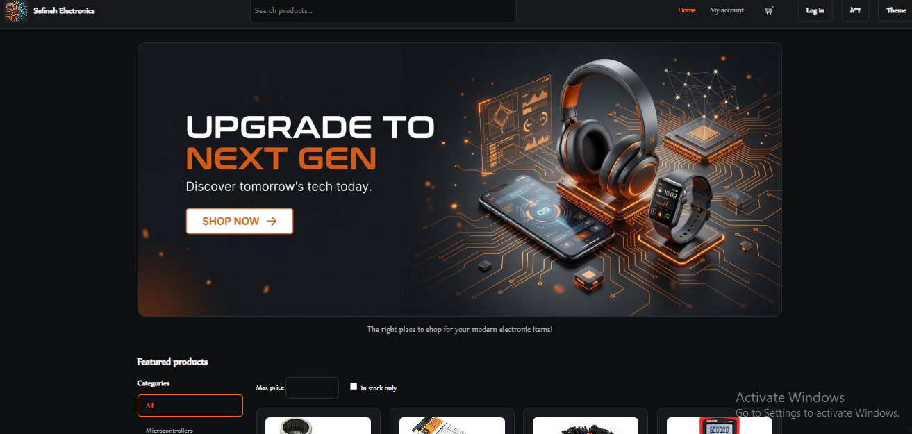
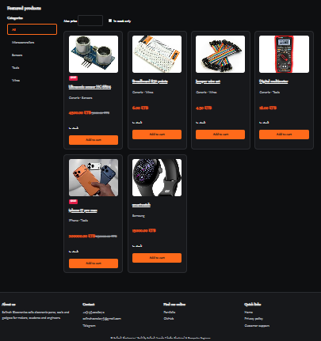
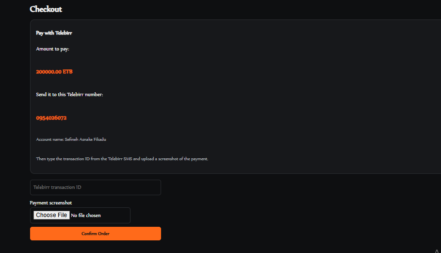
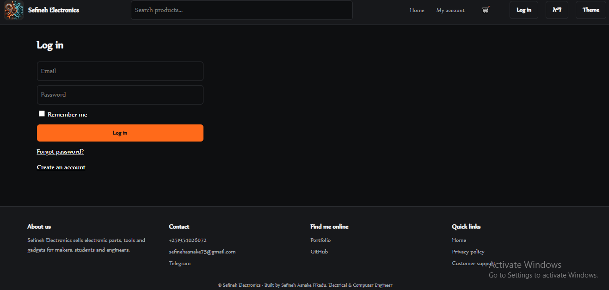
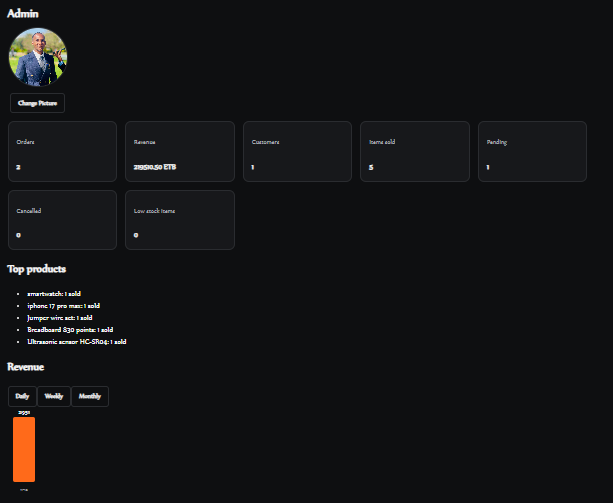
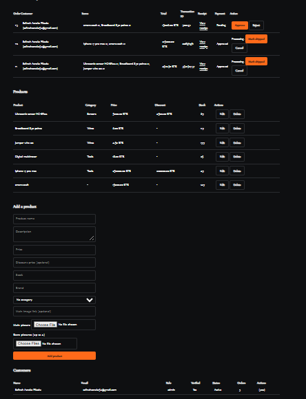

# 🛒 Fullstack E-commerce & Analytics

A production-ready, bilingual (English / አማርኛ) e-commerce platform. A **PHP REST API** runs the shop, and a separate **Python Flask microservice** provides admin analytics. Both share one **SQLite** database and ship in a single **Docker** container, deployed on **Render**.


**Live demo:** https://fullstack-ecommerce-analytics.onrender.com

---

## 🔄 Project Evolution

This is the production evolution of my earlier mobile-built system, [`ecommerce-dual-backend`](https://github.com/Sefineh12/ecommerce-dual-backend). That version was a dual-backend microservice architecture developed on Android with Termux: a PHP REST API, a Python Flask service and MariaDB.

| | Original (Termux) | Current (this repo) |
|---|---|---|
| Workspace | Android phone (Termux) | PC, Git, Docker |
| Database | MariaDB server | SQLite3 (serverless, WAL mode) |
| Frontend | Basic pages | Single-page app with dark/light theme and EN/አማ switch |
| Runtime | Manually started services | One container: nginx + PHP + Flask (gunicorn) |
| Config | Local settings | Environment variables, no secrets in code |
| Hosting | Local device | Render.com (Frankfurt) |

## 🏗️ Architecture

```
Browser ──► nginx (Render PORT) ──► PHP server :8000 ──► SQLite  (DATA_DIR/shop.db)
              │  static files, uploads        │                      ▲
              │                               └─ admin only ─► Flask :8001 (read-only)
```

- **nginx** is the only public entry point. It serves static files and uploads and proxies everything else to PHP.
- **PHP** serves the REST API (`/api/*`), email verification pages and admin-only analytics (`/analytics/*`).
- **Flask** (gunicorn) listens on `127.0.0.1:8001`, opens the database **read-only**, and is never exposed publicly.
- **SQLite** lives in `DATA_DIR`, so a Render persistent disk keeps data between deploys.

## ✨ Features

**Storefront**
- Product catalog with categories, search, price and in-stock filters, sale prices and a product page with an image gallery
- Cart that survives page reloads
- Manual **Telebirr** checkout: transaction ID plus payment screenshot upload
- Customer reviews (verified buyers only) and a wishlist
- Bilingual interface (English / አማርኛ) and a dark/light theme

**Accounts & security**
- Registration with **email verification** (Gmail SMTP), login with "Remember me"
- Forgot/reset password with 15-minute tokens and a 2-minute resend cooldown
- Customer dashboard: profile, round profile photo, order history, wishlist, password change
- Notification bell for payment and order-status updates
- `password_hash`, PDO prepared statements, CSRF tokens, session regeneration, hashed email tokens, login rate limiting, content-checked image uploads, private receipt storage

**Admin panel**
- Verify Telebirr payments (approve/reject) and move orders through *Processing → Shipped → Delivered / Cancelled*
- Product CRUD with multi-image upload, categories, brand and discount price
- Customer management (roles, ban/unban) and review moderation
- Low-stock alerts

**Flask analytics microservice**
- Revenue per day / week / month, items sold, pending and cancelled orders, top products
- Counts only paid, non-cancelled orders; reachable only through the admin-protected PHP route

## 🧰 Tech Stack

| Layer | Technology |
|---|---|
| Frontend | HTML5, CSS3, vanilla JavaScript (no build step) |
| Shop backend | PHP 8.4 (PDO), nginx reverse proxy |
| Analytics | Python 3, Flask, gunicorn |
| Database | SQLite3 |
| DevOps | Docker, Render.com |

## 🖼️ Screenshots

| | |
|---|---|
|  |  |
|  |  |
|  |  |

## 🚀 Getting Started

### Run with Docker

```bash
git clone https://github.com/Sefineh12/fullstack-ecommerce-analytics.git
cd fullstack-ecommerce-analytics
docker build -t fullstack-ecommerce-analytics .
docker run --rm -p 10000:10000 -e ADMIN_EMAIL=admin@example.com -e ADMIN_PASSWORD=ChangeMe123 -e BASE_URL=http://localhost:10000 -v shopdata:/app/storage fullstack-ecommerce-analytics
```

Open http://localhost:10000. On the first start, the container creates the database and the admin account from `ADMIN_EMAIL` and `ADMIN_PASSWORD`. If Gmail is not configured, verification links are printed in the container log.

<details>
<summary>Prefer Docker Compose? Save this as <code>docker-compose.yml</code> and run <code>docker-compose up --build</code></summary>

```yaml
services:
  shop:
    build: .
    ports:
      - "10000:10000"
    environment:
      ADMIN_EMAIL: ${ADMIN_EMAIL}
      ADMIN_PASSWORD: ${ADMIN_PASSWORD}
      GMAIL_USER: ${GMAIL_USER:-}
      GMAIL_APP_PASSWORD: ${GMAIL_APP_PASSWORD:-}
      BASE_URL: http://localhost:10000
    volumes:
      - shopdata:/app/storage

volumes:
  shopdata:
```

Put your values in a `.env` file next to it (Compose reads it automatically).

</details>

### Run without Docker

Requires PHP 8.1+ (with `pdo_sqlite`, `openssl`) and Python 3.

```bash
cp .env.example .env            # fill in ADMIN_EMAIL and ADMIN_PASSWORD
php database/setup.php          # creates storage/shop.db and the admin account
php -S 127.0.0.1:8000 router.php
```

In a second terminal:

```bash
cd analytics
pip install flask
python app.py                   # listens on 127.0.0.1:8001
```

Open http://127.0.0.1:8000.

## ⚙️ Environment Variables

| Variable | Purpose |
|---|---|
| `ADMIN_EMAIL`, `ADMIN_PASSWORD` | Admin account created on the first start |
| `GMAIL_USER`, `GMAIL_APP_PASSWORD` | Gmail SMTP for verification and reset emails |
| `MAIL_FROM_NAME` | Sender name in emails |
| `BASE_URL` | Public address used in email links |
| `DATA_DIR` | Folder for the database and uploads (set to the persistent disk path on Render) |
| `PORT` | Public port (set automatically by Render) |
| `ANALYTICS_PORT`, `ANALYTICS_URL` | Optional: Flask port and the address PHP uses to reach it |

Never commit secrets. `.env` is ignored by Git and Docker.

## ☁️ Deploy to Render

1. Push the repo to GitHub and create a **Web Service** on Render with the **Docker** runtime (or use the included `render.yaml` Blueprint).
2. Attach a **persistent disk** (for example at `/var/data`) and set `DATA_DIR=/var/data`. Without a disk, the database and uploads are lost on every deploy.
3. Add the environment variables above in the Render dashboard.
4. Set the health check path to `/healthz`.

## 📁 Project Structure

```
├── api/              # PHP REST API (index.php), config.php, mail.php
├── analytics/        # Flask analytics service
├── database/         # schema.sql, setup.php
├── public/           # Frontend: index.html, style.css, app.js, data/*.json, assets/
├── docker/           # nginx.conf.template, start.sh, php.ini
├── router.php        # Front controller for the PHP server
├── Dockerfile
└── render.yaml
```

## 📄 License

Released under the **MIT License**. See [`LICENSE`](LICENSE) for details.

## 👤 Author

**Sefineh Asnake Fikadu**, Electrical & Computer Engineering
GitHub: [@sefineh12](https://github.com/sefineh12)